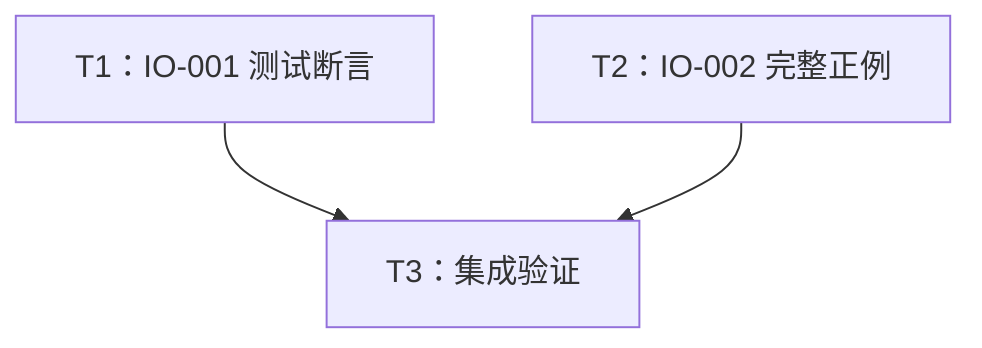

# rs-io 测试与字符 trait Rustdoc 改进实施计划

**目标：** 完成 IO-001、IO-002，以最小改动提高 BoxOutput 测试的可观察性和字符 trait 文档的可运行性。

**架构：** 保留现有所有生产行为及公开 API。一个测试使用共享观察状态；两个 Rustdoc 正例各自定义本地内存输入，通过公开 API 实际读写或定位并断言结果。

**技术栈：** Rust 2024、项目固定工具链 1.94.0、标准库、Cargo 集成测试和 doctest。

**项目目录：** `/data/working/qubit/rust-common/rs-io`。

**设计依据：** [设计文档](design-20261030T090034090Z-66eaaa0e.md)。计划直接保存在用户指定目录，不创建临时工作区或新的 Paseo workspace。

## 范围和全局约束

- 纳入 IO-001（P2）：目标 BoxOutput 转发测试缺少实际内容及刷新副作用断言。
- 纳入 IO-002（P3）：AsyncCharInput、SeekableCharInput 的正例没有构造流、实际调用及结果断言。
- 用户没有明确搁置或拒绝的正式条目；excluded 为空。
- unchecked 异步归一化候选没有列为正式意见，不纳入实现；不改其他 marker trait、vectored 转发、README、用户指南或下游。
- 只修改当前任务直接相关内容，不顺手重构、格式化或清理。
- CI 只验证当前 crate，不加入或保留下游 all-features 测试。
- 保留已有未提交修改和新增文件；不执行丢弃、覆盖或重置已有工作的操作。读取并遵守实施时适用的项目规则。
- Rustdoc 保持英文，类型名、公共签名、依赖和 feature 不变，无兼容性破坏或下游迁移。

本计划描述未来实施。当前方案生成阶段到两份文档交付即结束；实施、验证及 Git 操作是否执行，依据下一阶段命令及适用规则判断。本计划不将当前阶段限制写成未来验收条件，也不预先安排未经授权的提交步骤。

## 调度图

| 任务 | 前置任务 | 最小解锁产物 | 写入集合 | 本地验证 | 集成验证归属 | 审查时机 |
| --- | --- | --- | --- | --- | --- | --- |
| T1：IO-001 测试断言 | 无；与 T2 同一独立批次 | 当前目标测试和已有标准库 import | `tests/adapters/box_output_tests.rs` | 目标集成测试 | T3 | 完成后审查 |
| T2：IO-002 完整正例 | 无；与 T1 同一独立批次 | 现有公开 Input、AsyncInput、Seekable 接口 | `src/traits/async_char_input.rs`、`src/traits/seekable_char_input.rs` | 两处聚焦 doctest | T3 | 完成后审查 |
| T3：集成验证 | T1、T2 | 两项修改及聚焦验证结果 | 仅必要时局部修正上述三个文件 | diff 检查、当前 crate CI | T3 唯一负责 | 立即审查 |

T1、T2 写入集合独立，可以同批推进；不需要新增接口或接口提交来解锁。小任务默认由实施者直接完成，若下一阶段选择代理并行则遵循表内写入边界。Cargo 重型命令共用项目 target 资源，串行运行，避免锁竞争。

## 任务拓扑依赖图



## T1：IO-001 增加真实输出和刷新断言

**修改文件：** `tests/adapters/box_output_tests.rs`。只改本地 `CharOutput` 与 `test_box_output_forwards_trait_object_output`，保留其他测试。

**接口：** 对外仍是 `Box<dyn Output<Item = char>>`；新增观察状态只存在于测试。任务产物供 T3 验证，无生产接口依赖。

- [ ] 核对当前文件和 diff，确认 fixture 使用点。修改 Rust 测试前读取 `~/.agents/specs/rust-test.mdc` 及其他实际触发的规则，不因计划生成时未读取而跳过。
- [ ] 将原 `CharOutput` 改为以下共享状态。文件已有 Cell、RefCell、Rc 的独立 import，复用即可。

```rust
struct CharOutput {
    items: Rc<RefCell<Vec<char>>>,
    flushed: Rc<Cell<bool>>,
}

impl Output for CharOutput {
    type Item = char;

    fn is_buffered(&self) -> bool {
        true
    }

    unsafe fn write_unchecked(
        &mut self,
        input: &[char],
        index: usize,
        count: usize,
    ) -> io::Result<usize> {
        self.items.borrow_mut().extend_from_slice(&input[index..index + count]);
        Ok(count)
    }

    fn flush(&mut self) -> io::Result<()> {
        self.flushed.set(true);
        Ok(())
    }
}
```

- [ ] 用以下版本替换原目标测试，保留原来被检查的各入口。

```rust
#[test]
fn test_box_output_forwards_trait_object_output() {
    let items = Rc::new(RefCell::new(Vec::new()));
    let flushed = Rc::new(Cell::new(false));
    let inner: Box<dyn Output<Item = char>> = Box::new(CharOutput {
        items: Rc::clone(&items),
        flushed: Rc::clone(&flushed),
    });
    let mut output = BoxOutput::new(inner);

    assert!(output.is_buffered());
    assert!(output.get_ref().is_buffered());
    assert!(output.get_mut().is_buffered());
    assert!(items.borrow().is_empty());
    assert!(!flushed.get());

    // SAFETY: The source range 1..2 is valid.
    assert_eq!(1, unsafe { output.write_unchecked(&['a', 'b'], 1, 1) }
        .expect("unchecked write should succeed"));
    assert_eq!(*items.borrow(), ['b'], "unchecked write must reach the sink");

    assert_eq!(1, output.write(&['c']).expect("write should succeed"));
    assert_eq!(*items.borrow(), ['b', 'c'], "checked write must reach the sink");

    // SAFETY: The source range 0..1 is valid.
    unsafe { output.write_fully_unchecked(&['d', 'e'], 0, 1) }
        .expect("unchecked complete write should succeed");
    assert_eq!(*items.borrow(), ['b', 'c', 'd'], "complete unchecked write must reach the sink");

    output.write_fully(&['e']).expect("complete write should succeed");
    assert_eq!(*items.borrow(), ['b', 'c', 'd', 'e'], "complete write must reach the sink");
    assert!(!flushed.get(), "writes must not substitute for explicit flush");
    output.flush().expect("flush should succeed");
    assert!(flushed.get(), "flush must reach the sink");

    let inner = output.into_inner();
    assert!(inner.is_buffered());
    assert_eq!(*items.borrow(), ['b', 'c', 'd', 'e']);
    assert!(flushed.get());
}
```

- [ ] 在项目目录运行：

```bash
cargo test --locked --test adapters_tests adapters::box_output_tests::test_box_output_forwards_trait_object_output -- --exact
```

预期：目标测试被实际发现，恰好执行 1 项且通过；零项执行不算通过。该任务增强正确实现的回归检测，不需要让现有实现先失败，也不修改 BoxOutput 生产代码制造失败。

## T2：IO-002 补全两个字符 trait 正例

**修改文件：** `src/traits/async_char_input.rs`、`src/traits/seekable_char_input.rs` 的类型级 Rustdoc。保留所有原 compile_fail 反例、公开定义和实现。

**接口：** 示例只使用 `qubit_io` 公共路径。局部辅助类型不成为 crate API，T3 接收两个可以独立运行的 doctest。

- [ ] 核对当前文件；涉及 Rustdoc 时读取 `~/.agents/specs/rust-comment.mdc`，按实施时实际变更读取相关规则。
- [ ] 将 AsyncCharInput 的正例替换为以下完整示例。写入 Rustdoc 时每行加 `///`，解释段使用英文，说明这是始终就绪的内存流，因而不需要注册唤醒。

```rust
use std::io;
use std::pin::Pin;
use std::task::Context;
use std::task::Poll;
use std::task::Waker;

use qubit_io::AsyncCharInput;
use qubit_io::AsyncInput;

struct CharSlice<'a> {
    items: &'a [char],
    position: usize,
}

impl AsyncInput for CharSlice<'_> {
    type Item = char;

    unsafe fn poll_read_unchecked(
        self: Pin<&mut Self>,
        _cx: &mut Context<'_>,
        output: &mut [char],
        index: usize,
        count: usize,
    ) -> Poll<io::Result<usize>> {
        let this = self.get_mut();
        let read = count.min(this.items.len() - this.position);
        output[index..index + read]
            .copy_from_slice(&this.items[this.position..this.position + read]);
        this.position += read;
        Poll::Ready(Ok(read))
    }
}

fn read<S: AsyncCharInput + ?Sized>(
    stream: Pin<&mut S>,
    cx: &mut Context<'_>,
    output: &mut [char],
) -> Poll<io::Result<usize>> {
    stream.poll_read(cx, output)
}

let mut stream = CharSlice { items: &['你', '🦀'], position: 0 };
let mut cx = Context::from_waker(Waker::noop());
let mut output = ['\0'; 2];
assert!(matches!(read(Pin::new(&mut stream), &mut cx, &mut output), Poll::Ready(Ok(2))));
assert_eq!(output, ['你', '🦀']);
assert!(matches!(read(Pin::new(&mut stream), &mut cx, &mut output), Poll::Ready(Ok(0))));
```

- [ ] 将 SeekableCharInput 的正例替换为以下完整示例。英文说明中明确 seek 边界检查是示例内存流的选择，非 trait 新增限制。

```rust
use std::io;
use std::io::SeekFrom;

use qubit_io::Input;
use qubit_io::Seekable;
use qubit_io::SeekableCharInput;

struct CharCursor<'a> {
    items: &'a [char],
    position: usize,
}

impl Input for CharCursor<'_> {
    type Item = char;

    unsafe fn read_unchecked(
        &mut self,
        output: &mut [char],
        index: usize,
        count: usize,
    ) -> io::Result<usize> {
        let read = count.min(self.items.len() - self.position);
        output[index..index + read]
            .copy_from_slice(&self.items[self.position..self.position + read]);
        self.position += read;
        Ok(read)
    }
}

impl Seekable for CharCursor<'_> {
    type Unit = char;

    fn seek_to(&mut self, position: SeekFrom) -> io::Result<u64> {
        let target = match position {
            SeekFrom::Start(offset) => i128::from(offset),
            SeekFrom::Current(offset) => self.position as i128 + i128::from(offset),
            SeekFrom::End(offset) => self.items.len() as i128 + i128::from(offset),
        };
        if target < 0 || target > self.items.len() as i128 {
            return Err(io::Error::new(io::ErrorKind::InvalidInput, "outside the example input"));
        }
        self.position = target as usize;
        Ok(self.position as u64)
    }
}

fn rewind(stream: &mut dyn SeekableCharInput) -> io::Result<u64> {
    stream.seek_to(SeekFrom::Start(0))
}

let mut stream = CharCursor { items: &['你', '🦀', 'a'], position: 0 };
assert_eq!(stream.seek_to(SeekFrom::Start(1)).unwrap(), 1);
let mut output = ['\0'; 1];
assert_eq!(stream.read(&mut output).unwrap(), 1);
assert_eq!(output, ['🦀']);
assert_eq!(rewind(&mut stream).unwrap(), 0);
assert_eq!(stream.read(&mut output).unwrap(), 1);
assert_eq!(output, ['你']);
```

- [ ] 依次运行以下聚焦命令：

```bash
cargo test --locked --doc traits::async_char_input
cargo test --locked --doc traits::seekable_char_input
```

预期：第一条执行该模块的正例和既有 1 个 compile_fail 反例；第二条执行正例和既有 2 个 compile_fail 反例，均通过。若 Cargo 的 doctest 展示路径不同，先查看发现结果并调整过滤条件，不能接受零项执行。

## T3：统一审查和集成验证

**前置：** T1、T2 已完成；两项聚焦验证实际执行且通过，或明确记录环境阻断。

**写入边界：** 仅在必要时调整上述三个文件。无新接口、无下游变更。

- [ ] 检查最终 diff，确认生产函数体和 API 没有变化，两处反例均保留，原有用户修改仍在。不要将整个工作目录的既有 diff 全部归为本次产物。
- [ ] 按项目入口运行格式检查；需要局部格式调整时只处理本任务改动，避免使用会顺带改写全仓既有工作的流程。对 Markdown 中的代码方案与实际源码差异，以可编译、等价、最小修改为准。
- [ ] 运行以下当前 crate 集成检查，每项只在本任务集成阶段执行一次，除非失败或后续修改要求重跑：

```bash
git diff --check
./.infra/bin/style-check.sh
./.infra/bin/ci-check.sh
```

CI 负责项目已有的测试与 feature 矩阵等全量验证，不另行重复全量 coverage、benchmark、fuzz 或下游测试。若入口工具缺失或发生与既有修改相关的失败，记录原始输出并区分本次变更与基线问题，不为使全仓通过扩大修复范围。

- [ ] 自查 IO-001、IO-002 验收标准，交付三文件变更说明、实际命令及退出状态、未完成检查和原因。Git 提交或推送按下一阶段用户命令的明确授权执行，不由本计划推断授权。

## 验收清单与条目映射

- [ ] IO-001 → T1：保持 boxed trait object；四次写入各自观测正确累计内容；显式刷新前 false、刷新后 true；目标测试实际执行并通过。
- [ ] IO-002 → T2：两个正例各自完整构造流、实际调用、断言结果；展示 Unicode scalar 计数与定位；公共路径导入；不依赖执行器；原 compile_fail 反例保留并执行。
- [ ] 最小改动、兼容性及既有工作保护 → T3：仅三个目标文件需要实施改动，无生产行为/API/依赖变化，无下游迁移。
- [ ] 验证边界 → T3：当前 crate 项目检查；不新增或保留下游 all-features CI；实际环境失败如实报告，不将历史结果当作本次验证。

本计划在方案阶段仅经文本自查，以上复选框均保留未完成；不表示代码已修改或测试已经运行。
