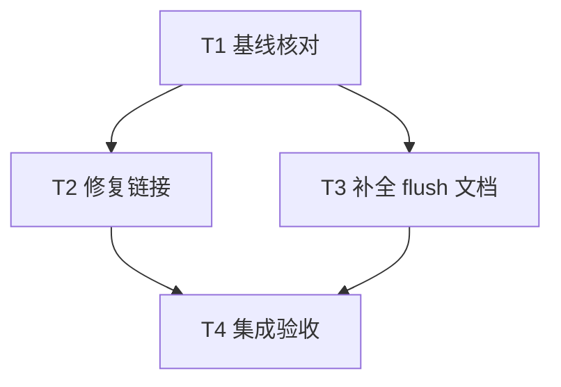

# rs-io Rustdoc 修复实施计划

**目标：** 以最小文档改动解决 IO-001、IO-002，保持公开 API 和运行时行为。

**架构：** 沿用现有结构；只修正错误类型链接和方法错误边界说明，不进行架构重构。

**技术栈：** Rust 2024、项目固定 Rust 1.94.0、rustdoc、Cargo。

**工作位置：** `/data/working/qubit/rust-common/rs-io`，继续使用当前 Paseo workspace。

**设计依据：** [Rustdoc 修复设计](design-20261030T174154421Z-0ad91b38.md)。

## 范围与约束

| 评审编号 | 状态 | 对应任务 |
| --- | --- | --- |
| IO-001 | 纳入；已确认，P2 | T1、T2、T4 |
| IO-002 | 纳入；已确认，P3 | T1、T3、T4 |

用户没有明确搁置或拒绝的条目；没有待验证疑点。默认纳入本轮全部意见，不需要重复确认范围或等待方案审批。

- 仅修改任务相关内容，不顺手重构、格式化或清理；保留已有及并发修改。
- 不创建或打开新的 Paseo workspace。
- CI 仅验证当前 crate，不加入或保留 downstream all-features 测试。
- 本计划不自行安排提交、推送或发布；相应操作依下一阶段用户明确授权和适用规则执行。
- 本计划直接使用用户指定文档路径，不另建临时计划工作区，不强制 worktree 或子智能体调度。下列任务很小，单个执行者即可完成。

## 调度图

| 任务 | 前置任务 | 最小解锁产物 | 写入集合 | 本地验证 | 集成验证归属 | 审查时机 |
| --- | --- | --- | --- | --- | --- | --- |
| T1 基线核对 | 无 | 当前源码、已有 diff 与实际文档诊断记录 | 无生产文件；验证产物使用正常 Cargo target | 源码与 Git 只读核对；修改前严格 Rustdoc 构建 | T4 | 立即审查 |
| T2 修复链接 | T1 | 当前 `ReadExt` 链接清单 | `src/std_io/ext/read_ext.rs` 的相关 Rustdoc | 阅读所有匹配链接和增量 diff | T4 | 批量审查 |
| T3 补全 flush 文档 | T1 | 当前 flush 实现、指南与测试证据 | `src/wrappers/tee_output.rs` 的 flush Rustdoc | 逐分支核对实现、文案和既有测试 | T4 | 批量审查 |
| T4 集成验收 | T2、T3 | 两项文档修复 | 无新增源码；验证产物使用正常 Cargo target | 严格 Rustdoc 构建、定向测试、增量 diff | 本任务 | 立即审查 |

T2、T3 属同一可并行批次，写入集合不相交；单执行者可依次完成，无需为两个小修改启动额外代理。修改后的文档构建统一由 T4 执行，避免重复编译。T1 与 T4 共享 Cargo target，按依赖顺序执行。

## 任务拓扑依赖图



## T1：核对基线并记录实际诊断

- [ ] 阅读目标目录当前适用的 `AGENTS.md` 和本阶段实际触发的规则。用户给定的全局规则仍有效；不要为了了解规则体系读取无关规范。
- [ ] 在目标项目执行 `git status --short` 及 `git diff -- src/std_io/ext/read_ext.rs src/wrappers/tee_output.rs`，记录原有修改；不重置或覆盖它们。
- [ ] 重新阅读 `ReadExt` 的导入及错误链接、`TeeOutput::flush` 的实现、`doc/user_guide.md` 中 tee 说明，以及 `test_tee_output_reports_branch_error_after_primary_progress`。若已被其他修改修复，按实际情况跳过重复编辑并保留验证任务。
- [ ] 执行修改前的严格文档构建，记录退出码和真实诊断：

```bash
RUSTDOCFLAGS="${RUSTDOCFLAGS:+$RUSTDOCFLAGS }-D rustdoc::broken_intra_doc_links" cargo doc --locked --no-deps --all-features
```

预期当前 `ReadExt` 的 `ErrorKind` 链接产生解析错误；以真实输出为准，不要求诊断条数恰好为 59。若依赖、工具链或网络问题使构建未到达 rustdoc，记录环境阻断，不将其描述为复现成功，也不擅自更新锁文件或依赖。实现前的静态修正仍可继续，完成结论须保留未验证范围。

## T2：修复 IO-001 的错误类型链接

**唯一修改文件：** `src/std_io/ext/read_ext.rs`。

- [ ] 枚举当前文件全部 ``[`ErrorKind::…`]`` 文档链接，确认对应标准库错误变体。
- [ ] 逐项改为全限定路径，例如：

```rust
/// [`std::io::ErrorKind::UnexpectedEof`] when EOF is reached before `count` bytes
```

同样处理 `Interrupted`、`InvalidData`、`OutOfMemory` 等当前实际出现的链接。只修改此文件中相关文档链接，不添加导入，不修改可执行代码或其他文件。

- [ ] 阅读本次增量 diff，确认未遗留未限定的 `ErrorKind` 文档链接，且原有描述、方法签名和实现保持原样。最终构建由 T4 统一执行。

## T3：补全 IO-002 的 flush 方法文档

**唯一修改文件：** `src/wrappers/tee_output.rs`。

- [ ] 将 `flush` 方法的 Rustdoc 替换为以下准确文案，保持属性、签名和方法体原样：

```rust
/// Reports a latched branch error, or flushes the primary and then the branch.
///
/// # Returns
///
/// Returns `Ok(())` after both outputs are flushed.
///
/// # Errors
///
/// Returns a previously latched branch write error without flushing either
/// output. The primary may still contain buffered items; use
/// [`into_parts`](Self::into_parts) to recover the outputs and inspect their
/// state before deciding how to continue. Do not blindly replay items already
/// accepted by the primary.
///
/// If no branch write error is latched, returns the primary flush error
/// without flushing the branch, or returns the branch flush error after the
/// primary has flushed successfully.
```

- [ ] 对照实现核对三条路径：已锁存错误直接返回；主路刷新失败时不刷新分支；主路成功后才刷新分支。不将“接受数据”或“刷新”表述成持久化保证。
- [ ] 确认 `Self::into_parts` 是现有公开方法；保留指南和类型级已有正确说明，不新增重复文档或测试文本快照。最终构建和既有行为测试由 T4 统一执行。

## T4：集成验证与结果交付

工作目录均为 `/data/working/qubit/rust-common/rs-io`。

- [ ] 执行修改后的严格文档构建：

```bash
RUSTDOCFLAGS="${RUSTDOCFLAGS:+$RUSTDOCFLAGS }-D rustdoc::broken_intra_doc_links" cargo doc --locked --no-deps --all-features
```

预期退出码 0，且没有 broken intra-doc links。此处 `--all-features` 只选择当前 crate 的 features，不运行下游测试。

- [ ] 查看本次生成的 `target/doc/qubit_io/std_io/ext/trait.ReadExt.html`，抽查 `UnexpectedEof`、`Interrupted`、`InvalidData`、`OutOfMemory` 链接确实指向标准库对应变体；查看 `target/doc/qubit_io/struct.TeeOutput.html` 的 `Output::flush` 实现文档，确认提前返回条件、两路不刷新及恢复链接均正确。
- [ ] 运行现有定向测试，不新增测试文件：

```bash
cargo test --locked --test wrappers_tests test_tee_output_reports_branch_error_after_primary_progress
```

预期测试实际运行 1 项并通过；若显示 0 项，核对当前测试目标及函数路径后重新使用正确筛选器，不能将空筛选结果视为通过。该测试验证既有锁存错误行为保持不变，不用于验证注释文字。

- [ ] 执行 `git diff --check -- src/std_io/ext/read_ext.rs src/wrappers/tee_output.rs`，并对照 T1 基线阅读两文件 diff。预期本任务只增加文档注释修改；若原有改动导致诊断，单独标明来源，不顺手格式化或修复无关内容。
- [ ] 交付 IO-001、IO-002 的完成状态、实际命令与退出码、未验证或失败范围。无需为这两项注释修复追加 coverage、benchmark、fuzz、下游构建或下游 all-features 测试。

## 验收映射与计划自检

| 必须项 | 任务及验收依据 |
| --- | --- |
| IO-001 所有相关链接可解析 | T2 改动清单；T4 严格 Rustdoc 构建和生成链接抽查 |
| IO-002 方法文档准确覆盖提前返回与健康路径 | T3 逐分支核对；T4 生成文档检查 |
| 既有行为保持不变 | T2、T3 仅改注释；T4 既有锁存错误测试 |
| 保留原树已有修改、维持最小范围 | T1 基线与 T4 增量 diff |
| 无需调用方迁移，CI 仅验证本 crate | 本设计的兼容性结论与 T4 命令范围 |
| 采纳及排除范围明确 | 本计划范围表：纳入 IO-001、IO-002，无明确排除项 |

调度表、拓扑图和任务列表统一使用 T1、T2、T3、T4；无新增接口、依赖或迁移步骤。验证失败时报告具体原因，不将历史验证记录当作本次成功证据。
